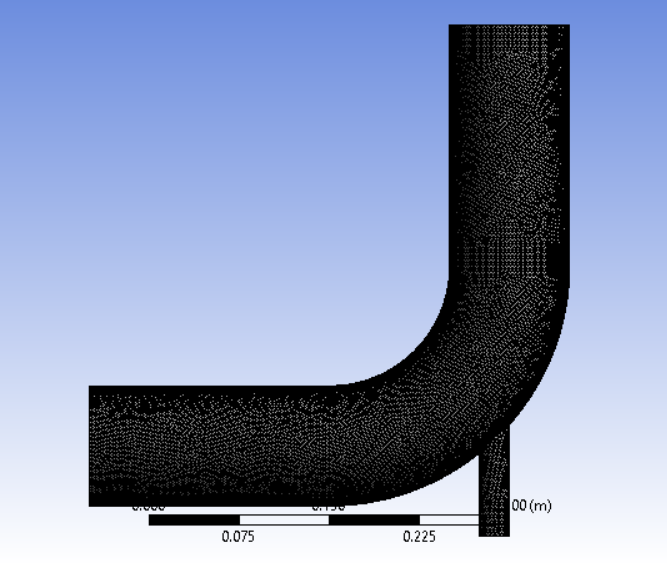
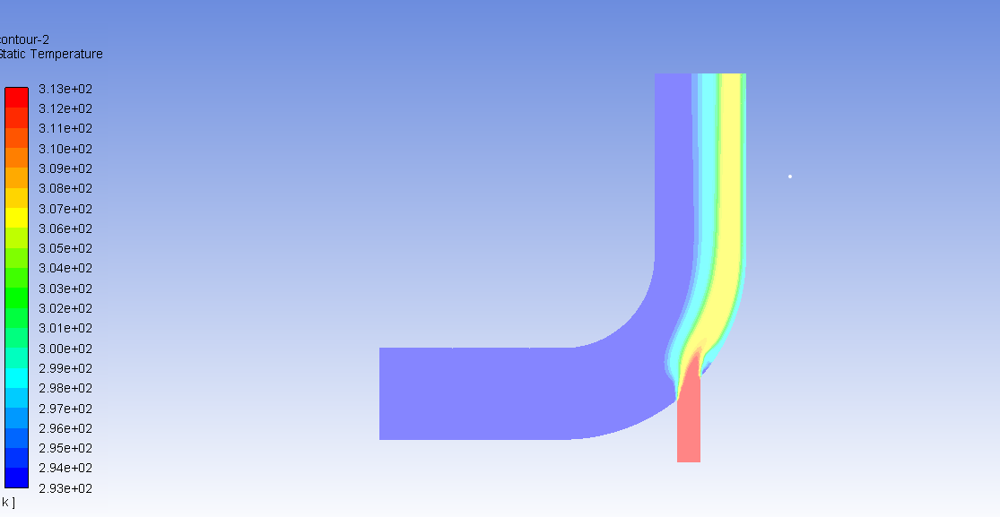
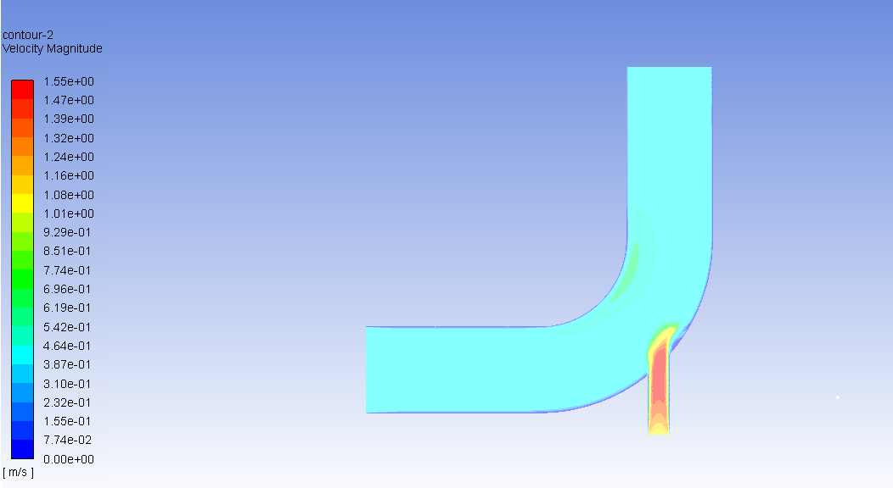

# CFD Analysis of Flow and Temperature Distribution in an Elbow Using ANSYS Fluent

## 1. Project Overview

This project investigates fluid flow and temperature distribution in an elbow-shaped passage using Computational Fluid Dynamics (CFD) in ANSYS Fluent. The geometry consists of two velocity inlets and one pressure outlet.

The simulation analyzes velocity and temperature distributions under different inlet conditions using numerical solution methods and CFD post-processing.

## 2. Project Objectives

- Analyze fluid flow through an elbow-shaped passage.
- Investigate velocity-magnitude distribution near the elbow and inlet junctions.
- Examine temperature distribution under different inlet conditions.
- Apply CFD modelling, numerical methods, and post-processing techniques.

## 3. Software and Physical Models

| Parameter | Description |
|---|---|
| CFD Software | ANSYS Fluent |
| Geometry | Elbow-shaped passage with two inlets |
| Working Fluid | Water (`water-liquid` assigned to the fluid cell zone) |
| Other Defined Materials | Air and aluminium |
| Energy Equation | Enabled |
| Turbulence Model | k-epsilon (specific variant to be confirmed) |
| Pressure-Velocity Coupling | SIMPLE |
| Gradient Method | Least Squares Cell Based |
| Pressure Discretization | Second Order |
| Momentum Discretization | Second Order Upwind |
| Turbulent Kinetic Energy | First Order Upwind |
| Turbulent Dissipation Rate | First Order Upwind |
| Maximum Iterations Set | 150 |

## 4. Boundary Conditions

| Boundary | Type | Specification |
|---|---|---|
| Large Inlet | Velocity Inlet | Velocity: 0.4 m/s; Temperature: 293.15 K |
| Small Inlet | Velocity Inlet | Velocity: 1.2 m/s; Temperature: 313.15 K |
| Outlet | Pressure Outlet | Pressure outlet boundary condition |
| Walls | Wall | No-slip condition |

## 5. Computational Mesh

The computational mesh discretizes the flow domain into cells for numerical solution of the governing equations.

## 6. Results and Visualization

### 6.1 Static Temperature Contour

The static-temperature contour illustrates temperature variations throughout the passage. The displayed temperature range is approximately 293–313 K.

### 6.2 Velocity Magnitude Contour

The velocity-magnitude contour illustrates spatial variations in flow velocity, including localized changes near the inlet junction and elbow. The displayed velocity range is approximately 0–1.55 m/s.

## 7. Preliminary Observations

- The velocity contour shows spatial variations in velocity magnitude across the flow domain.
- The temperature contour displays different temperature regions under the specified inlet conditions.
- The two inlets introduce fluid at different velocities and temperatures, influencing the resulting flow and temperature fields.

These observations are qualitative and based on the available contour plots. Quantitative performance comparisons have not been established.

## 8. Numerical Methods

The simulation used the SIMPLE pressure-velocity coupling scheme. Pressure was discretized using the second-order scheme, while momentum used second-order upwind discretization. Turbulent kinetic energy and turbulent dissipation rate used first-order upwind discretization.

The maximum iteration count was set to 150. Convergence must be assessed separately using residual histories and relevant solution monitors.

## 9. Limitations

- Quantitative pressure-drop and mass-flow-rate results are not available.
- Residual histories and convergence assessments have not been documented.
- Mesh independence and experimental validation have not been established.

## 10. Future Work

- Assess numerical convergence using residual histories and solution monitors.
- Extract pressure differences and mass-flow rates.
- Analyze velocity and temperature at selected locations.
- Conduct a mesh-independence study.
- Validate simulation results against suitable reference data, where available.

## 11. Skills Demonstrated

- Computational Fluid Dynamics (CFD)
- ANSYS Fluent
- Fluid Mechanics and Internal Flow
- Turbulence Modelling
- Boundary-Condition Setup
- Numerical Solution Methods
- Velocity and Temperature Contour Analysis
- CFD Post-Processing

## 12. Conclusion

This project demonstrates the application of ANSYS Fluent to investigate flow and temperature distributions in an elbow-shaped passage with two inlets and one pressure outlet. The available contours provide a qualitative understanding of the simulated flow field. Further convergence assessment and quantitative analysis are required to evaluate the reliability and predictive accuracy of the results.

